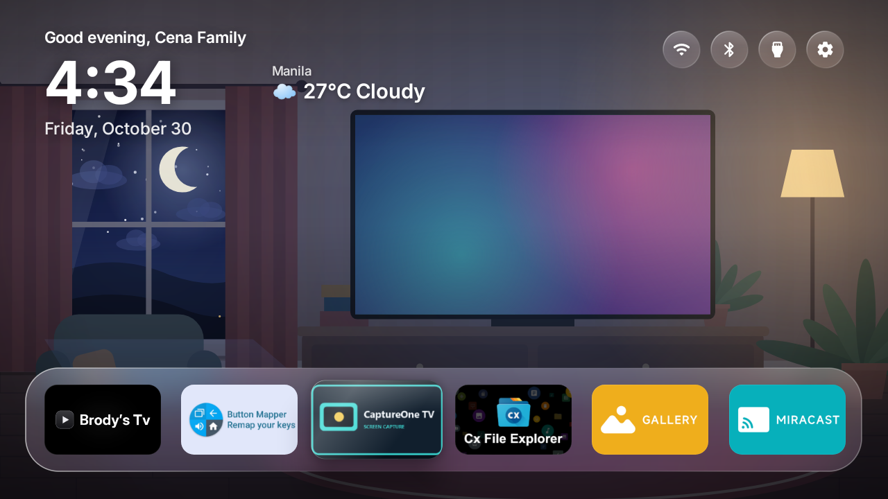
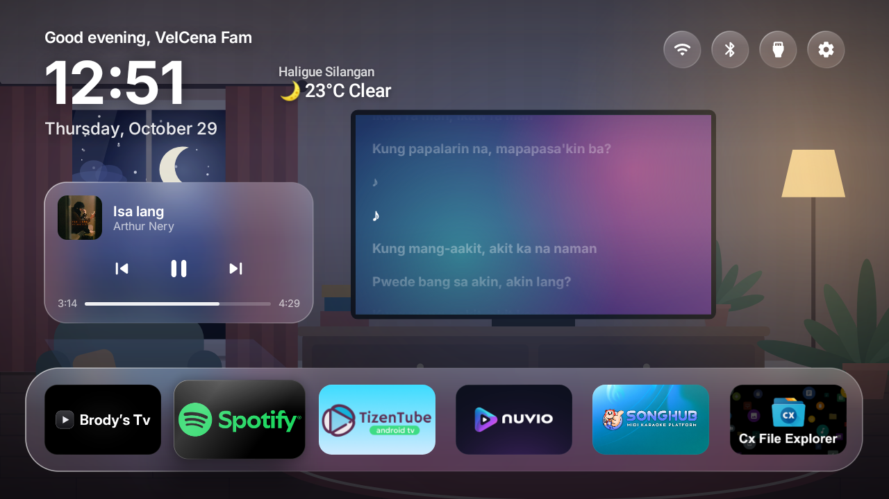
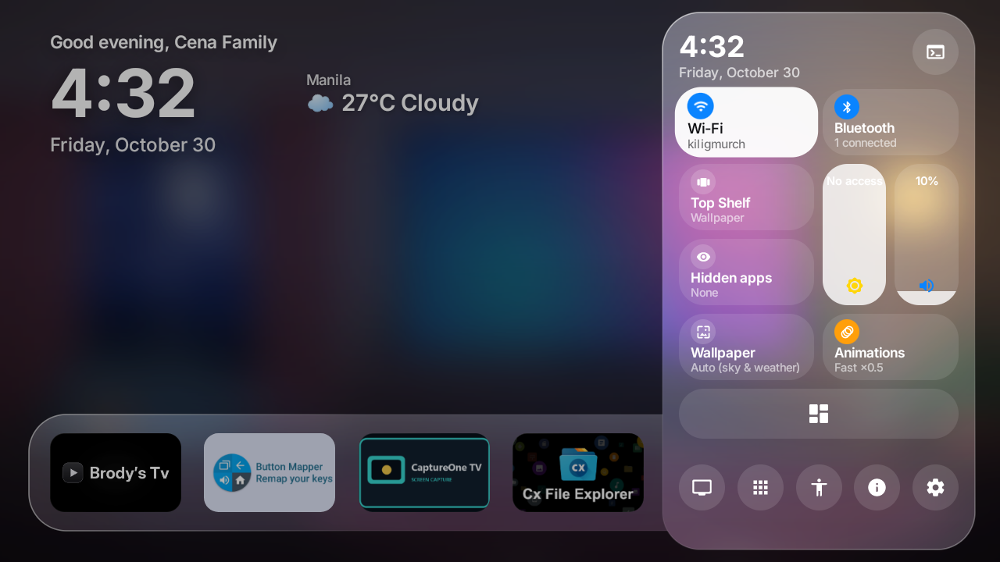
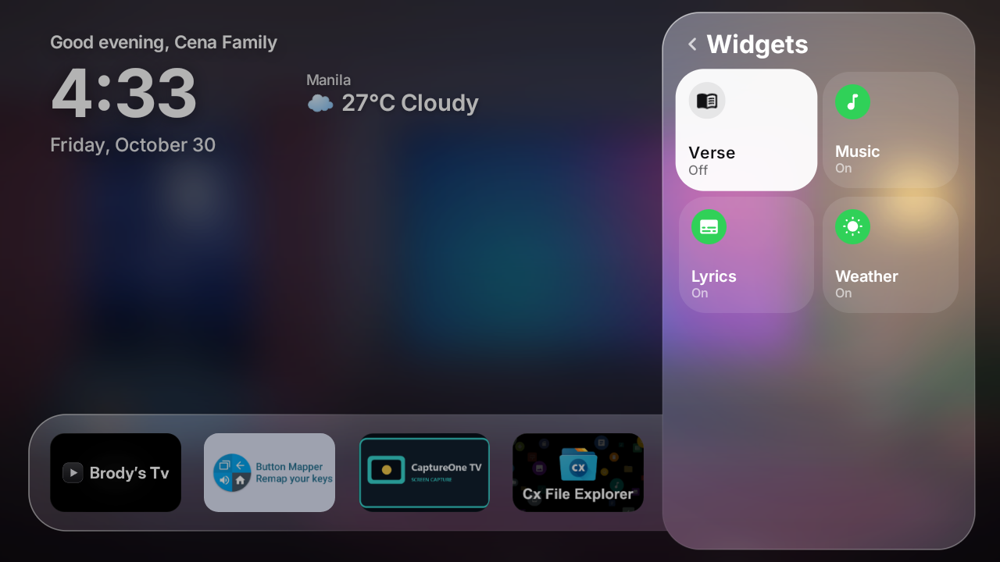
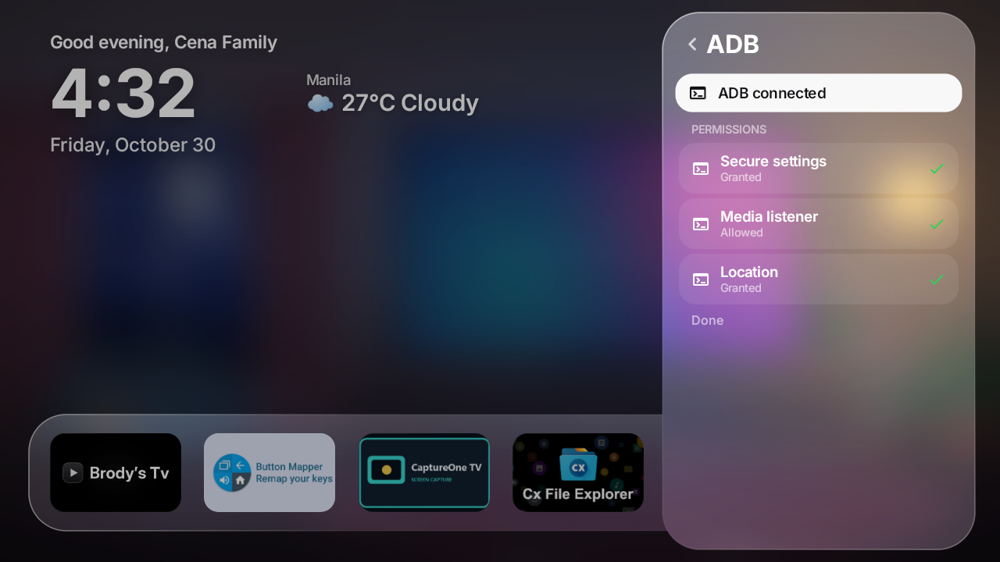
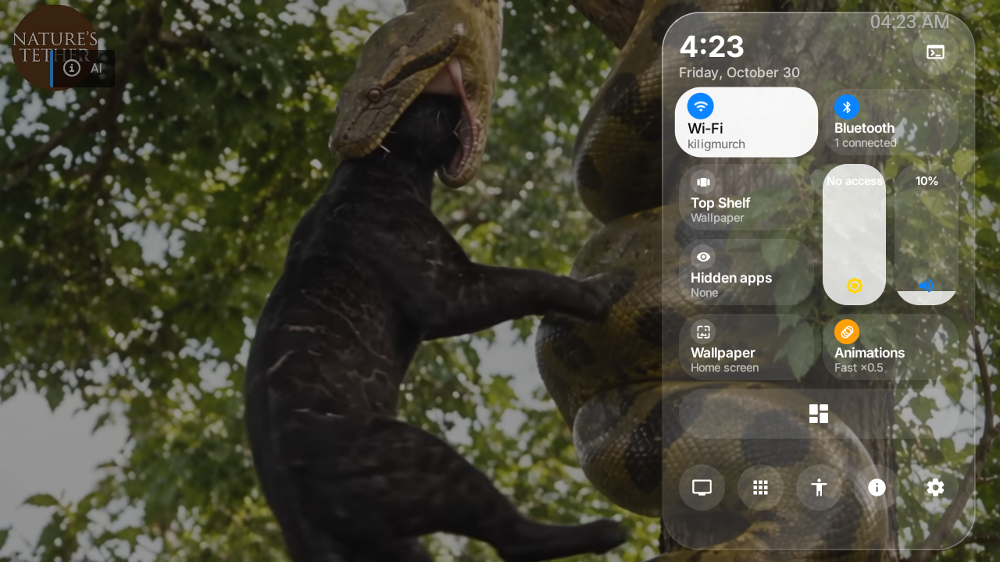

# Glass – a tvOS-style home screen for Android TV

Glass replaces the home screen of an Android TV or Fire TV with a tvOS-inspired interface made of "Liquid Glass" panels. It runs on **Android 7.1 and later**, including older Fire TV devices (Fire OS 6) where recent launchers won't install.

This is a fork of [tlfares/GlassLauncher](https://github.com/tlfares/GlassLauncher) with extra features (see below).

**Download page:** https://lwrnccena-ctrl.github.io/GlassLauncher/

## Screenshots








| Control Center | Widgets |
| --- | --- |
| 



 | 



 |

| ADB permissions | Overlay on top of a video |
| --- | --- |
| 



 | 



 |

## Features

- **Home:** greeting with your name, large clock and date, a glass dock of 6 apps, and a 6-column grid below.
- **Real logos:** each app's Android TV banner fills its card. Otherwise you get its logo on its own background color, or logo and name on white, like a TV banner.
- **tvOS focus:** springy zoom, shadow, 3D tilt toward the move direction, and sheen.
- **Organize:** long-press OK, then choose Move (the icon jiggles), Hide, or App info.
- **Control Center:** open it with the menu key, the top buttons, or the yellow button on the remote. It slides in from the right.
  - **Wi-Fi:** status, current network and IP, nearby networks, and connecting with a password.
  - **Bluetooth:** paired devices and their status, search, pairing, and forgetting (the remote is protected).
  - **Quick actions:** Miracast, Hidden apps, Screen dim, Screenshot, Sleep and Shutdown.
  - **System:** memory, storage, and IP.
  - **Personalization:** animation speed, wallpaper, Top Shelf, and hidden apps, in the bottom-middle of the Control Center.
  - Shortcuts to the settings screens the TV lets apps open.
- **Wallpapers:** four abstract styles generated by the app, or your own photo.
- **Languages:** English, French, Spanish, Portuguese (European and Brazilian) and German, following the device language.

## What's new in this fork

- **Intro scene:** on first launch you enter your name, and Glass uses it in the greeting at the top of the clock.
- **Easy setup:** Glass sets itself up using a native ADB built into the app, plus the accessibility service. No computer needed.
- **In-app updates:** Glass checks for updates automatically and downloads them inside the app, with no browser needed.
- **Remote color buttons:**
  - **Yellow:** open and close the Control Center on the home screen or on top of any other app.
  - **Blue:** open and close the Weather tab.
- **Control Center overlay:** open the Control Center as an overlay on top of other apps, using an Android accessibility service.
- **Quick actions:** new Control Center shortcuts for Miracast, Hidden apps, Screen dim, Screenshot, Sleep and Shutdown.
- **Cleaner Control Center:** personalization settings moved off the main page to the bottom-middle.
- **Home override:** an accessibility setting that makes the Home button open Glass.
- **Weather:** current weather on the home screen.
- **Recent apps:** jump back to the apps you used last.
- **Lyrics:** song lyrics for the music that is playing.
- **Media playback controls:** play, pause and skip from Glass without opening the music app.
- **Widgets panel:** turn the Verse, Music, Lyrics and Weather widgets on or off from the Control Center.
- **ADB panel:** shows whether ADB is connected and the status of the secure settings, media listener and location permissions. Connect instantly using native ADB (USB debugging must be on).
- **Auto wallpaper:** a wallpaper mode that follows the sky and weather.

## Remote shortcuts

| Button | Action |
| --- | --- |
| Yellow | Open or close the Control Center, on the home screen or over any other app |
| Blue | Open or close the Weather tab |

## Install

1. Open the [latest release](https://github.com/lwrnccena-ctrl/GlassLauncher/releases/latest) and download the APK under Assets.
2. Put it on your TV: use the Downloader app on the TV, or copy the file with a USB drive.
3. Allow installs from unknown sources for the app you open the APK with (usually under Settings › Apps › Special app access).
4. Open the APK and choose Install. Or from a computer: `adb install Glass.apk`
5. Press the Home button and choose Glass when asked. Upgrading keeps your settings.
6. Follow the intro to enter your name and finish the easy setup.

After the first install, Glass checks for updates by itself and downloads new versions inside the app, so you don't need a browser again.

## Troubleshooting

If the Wi-Fi list stays empty, check that location is turned on (Android 9 to 12 only list networks while location is on). To see why a scan failed, run:

```
adb logcat -s Glass
```

## Credits and license

Based on the original Glass launcher by [tlfares](https://github.com/tlfares/GlassLauncher). See the [LICENSE](LICENSE) file for the license terms.
